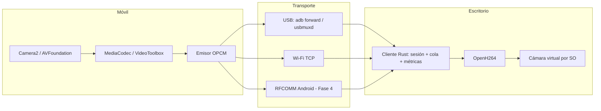

# OpenCam: arquitectura

OpenCam convierte un móvil Android o iPhone en webcam del ordenador. El móvil captura y codifica por hardware; el PC recibe, decodifica y publica una cámara virtual.

## Diagrama



## Decisiones

- **Escritorio: CLI en Rust.** El cliente de escritorio es un programa de línea de órdenes que decodifica H.264 con OpenH264 (crate `openh264`). Tauri (interfaz gráfica) y FFmpeg/libav quedan como trabajo futuro.
- **Protocolo en tres sitios.** `core/` (Rust) implementa OPCM para el escritorio y sirve de referencia de pruebas. Las apps móviles lo reimplementan en Kotlin y Swift. `docs/PROTOCOL.md` es la fuente común de los tres.
- **Codificación en el móvil.** Solo el móvil accede al sensor y a los codificadores. El escritorio recibe H.264 ya comprimido.
- **TCP como transporte único.** USB (ADB o usbmuxd) y Wi-Fi exponen TCP, así que el mismo protocolo sirve para todo. Bluetooth Classic solo tiene 2-3 Mbps útiles y se reserva para la Fase 4.
- **Baja latencia por diseño.** Cola acotada, descarte de frames antiguos y solicitud de keyframe ante pérdidas. Se prefiere perder un frame a acumular retraso.
- **Móvil como servidor, PC como cliente.** El PC conecta cuando el túnel USB está listo, y no hace falta abrir puertos en el móvil.

## Matriz de compatibilidad

| Móvil / Transporte | USB | Wi-Fi | Bluetooth |
|---|---|---|---|
| Android | `adb forward` (sin root) | Sí | RFCOMM, 480p-720p, 15-24 fps (Fase 4, pendiente) |
| iPhone | usbmuxd (sin jailbreak) | Sí (Bonjour) | Solo BLE para control; sin vídeo (pendiente) |

## Límites a documentar

- iOS no captura cámara en segundo plano. La app debe estar en primer plano, con modo de pantalla atenuada.
- Windows necesita el driver de Apple para usbmuxd con iPhone. Linux necesita `usbmuxd` y `libimobiledevice`. macOS lo trae integrado.
- Sin root en Android ni jailbreak en iOS.
- El iPhone solo se usa desde el escritorio por USB (`opencam-desktop iphone`); no hay ruta iPhone en Windows.

## Bitrates

Valores objetivo del diseño. El cliente pide H.264 a 1080p30 y 8000 kbps por defecto (`--width`, `--height`, `--fps`, `--bitrate`).

| Conexión | Resolución / fps | Códec | Bitrate |
|---|---|---|---|
| USB 3 / USB 2 | 1080p30 | H.264 | 6-8 Mbps |
| USB 3 / USB 2 | 1080p60 | H.265 | 10-12 Mbps (H.265 pendiente) |
| USB 3 / USB 2 | 4K30 | H.265 | 18-25 Mbps (4K y H.265 pendientes) |
| Wi-Fi 5 GHz | 1080p30 | H.264 | 6-8 Mbps |
| Wi-Fi 5 GHz | 4K30 | H.265 | 15-20 Mbps (pendiente) |
| Bluetooth Android | 720p15-24 | H.264 | 1-2 Mbps (Fase 4) |

El móvil ajusta el bitrate según la pérdida y el RTT que reporta el escritorio, con STATS. El móvil ya aplica STATS; el escritorio todavía no lo envía (ver estado).

## Estado

Leyenda:

- **Hecho**: implementado y con prueba automática (tests unitarios o CI) donde aplica.
- **Parcial**: el camino está implementado solo en parte.
- **No verificado**: implementado, pero solo compilado en CI o revisado a mano. No se ha ejecutado en el hardware.
- **Pendiente**: no implementado.

### Por función

| Función | Estado | Detalle |
|---|---|---|
| Protocolo OPCM v1 | Hecho | `core/`: 29 tests pasan. Cabecera, tipos de mensaje, HELLO/CAPS, CONFIG, STATS, PING/PONG. |
| STATS y control de bitrate | Parcial | `core/`: métricas EWMA y controlador AIMD con tests. Móviles: aplican STATS recibido (Android `setBitrate`, iOS `AverageBitRate`). Escritorio: no mide ni envía STATS. |
| Reconexión | Hecho (escritorio) | `desktop/src/session.rs` reconecta con backoff y repite el handshake; test automático. Sin probar con un móvil real. `core/src/reconnect.rs` existe pero el cliente aún usa su backoff local. |
| Descubrimiento mDNS / NSD / Bonjour | Parcial | Android anuncia con NSD y iOS con Bonjour (`_opencam._tcp`). El escritorio tiene `discovery.rs`, pero `main.rs` no lo declara, así que no se compila ni se usa. |
| CAPS reales en Android | No verificado | `Caps.kt` (rangos de fps, lente) con tests JVM. Sin móvil. |
| Cola de envío y robustez Android | No verificado | `StreamService.kt` y `OpcmServer.kt`; tests JVM en `OpcmTest.kt`. |
| Proyecto XcodeGen iOS | No verificado | `ios/project.yml`. Sin Xcode: no se ha generado ni compilado. |
| Captura iOS con presets 3840 / 1920 / 1280 | No verificado | `CameraStreamer.swift`. H.264 solo. |
| Salida Y4M (archivo o stdout) | Parcial | `desktop/src/sink.rs` con tests. No está conectada a la CLI, así que macOS no tiene salida. |
| Cámara virtual Linux (v4l2loopback) | No verificado | Compila. Sin probar con el módulo cargado. |
| Cámara virtual Windows (DirectShow) | No verificado | Memoria compartida (`sink_windows.rs`, `shared_frame`) y filtro (`windows-vcam/`). `IAMStreamConfig` e `IKsPropertySet` implementados en `pin.rs`, con 1080p, 720p y 480p. CI compila la DLL. Sin registrar ni ejecutar. |
| Instalador Windows | No verificado | `desktop/windows-installer/opencam.nsi`. CI valida la sintaxis con binarios de prueba. |
| Cámara virtual macOS | Pendiente | El binario compila, pero termina con error al arrancar. |
| H.265 y 4K en escritorio | Pendiente | Trabajo futuro. El escritorio solo decodifica H.264 con OpenH264. |
| Audio y micrófono virtual | Pendiente | Fase 3. |
| Bluetooth Android | Pendiente | Fase 4. |
| Interfaz gráfica | Pendiente | Tauri queda como trabajo futuro; hoy es una CLI. |

### Por fase

1. **MVP** (Android + Windows, 1080p por USB, cámara virtual): **Parcial**. El código de ambos lados existe y el escritorio tiene tests. Falta probarlo en hardware real.
2. **iPhone por USB, macOS y Linux**: **Parcial**. Linux tiene el cliente; el camino iPhone por usbmuxd está en el cliente y en la app iOS sin compilar; macOS espera la cámara virtual.
3. **4K, H.265, controles avanzados, audio y micrófono virtual**: **Pendiente**.
4. **Wi-Fi con descubrimiento, Bluetooth Android, ajustes avanzados**: **Parcial**. Wi-Fi TCP está en el cliente; el descubrimiento del escritorio no está enlazado. Bluetooth está pendiente.

## Estructura del monorepo

```
core/                       Núcleo Rust: protocolo OPCM, cola, métricas, bitrate, reconexión
desktop/                    Cliente de escritorio (CLI Rust, OpenH264)
desktop/src/                Sesión, cliente, decodificador, sinks Linux/Windows, usbmuxd
desktop/windows-vcam/       Filtro DirectShow (DLL), crate aparte
desktop/windows-installer/  Script NSIS del instalador de Windows
android/                    App Kotlin (Camera2 + MediaCodec)
ios/                        App Swift (AVFoundation + VideoToolbox), proyecto XcodeGen
site/                       Página de descargas (GitHub Pages)
docs/                       Arquitectura y protocolo
.github/workflows/          CI (tests, compilaciones, sintaxis del instalador) y release
```
