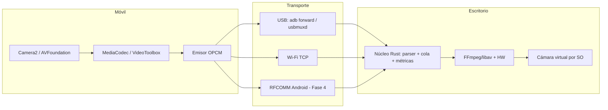

# OpenCam: arquitectura

OpenCam convierte un móvil Android o iPhone en webcam del ordenador. El móvil captura y codifica por hardware; el PC recibe, decodifica y publica una cámara virtual.

## Diagrama



## Decisiones

- **Núcleo compartido en Rust.** Protocolo, cola de frames, métricas y reconexión se escriben una vez y se testean en Linux. Las apps nativas no reimplementan el protocolo.
- **Codificación en el móvil.** Solo el móvil accede al sensor y a los codificadores. El escritorio recibe H.264 o H.265 ya comprimidos.
- **TCP como transporte único.** USB (ADB o usbmuxd) y Wi-Fi exponen TCP, así que el mismo protocolo sirve para todo. Bluetooth Classic solo tiene 2-3 Mbps útiles y se reserva para Fase 4.
- **Baja latencia por diseño.** Cola acotada, descarte de frames antiguos y solicitud de keyframe ante pérdidas. Se prefiere perder un frame a acumular retraso.
- **Móvil como servidor, PC como cliente.** Así el PC conecta cuando el túnel USB está listo, y no hace falta abrir puertos en el móvil.

## Matriz de compatibilidad

| Móvil / Transporte | USB | Wi-Fi | Bluetooth |
|---|---|---|---|
| Android | `adb forward` (sin root) | Sí | RFCOMM, 480p-720p, 15-24 fps (Fase 4) |
| iPhone | usbmuxd (sin jailbreak) | Sí (Bonjour) | Solo BLE para control; sin vídeo |

## Límites a documentar

- iOS no captura cámara en segundo plano. La app debe estar en primer plano, con modo de pantalla atenuada.
- Windows necesita el driver de Apple para usbmuxd con iPhone. Linux necesita `usbmuxd` y `libimobiledevice`. macOS lo trae integrado.
- Sin root en Android ni jailbreak en iOS.

## Bitrates recomendados

| Conexión | Resolución / fps | Códec | Bitrate |
|---|---|---|---|
| USB 3 / USB 2 | 1080p30 | H.264 | 6-8 Mbps |
| USB 3 / USB 2 | 1080p60 | H.265 | 10-12 Mbps |
| USB 3 / USB 2 | 4K30 | H.265 | 18-25 Mbps |
| Wi-Fi 5 GHz | 1080p30 | H.264 | 6-8 Mbps |
| Wi-Fi 5 GHz | 4K30 | H.265 | 15-20 Mbps |
| Bluetooth Android | 720p15-24 | H.264 | 1-2 Mbps |

El móvil ajusta el bitrate según la pérdida y el RTT que reporta el escritorio.

## Fases

1. **MVP**: Android + Windows, 1080p por USB, cámara virtual.
2. **iPhone por USB, macOS y Linux.**
3. **4K, H.265, controles avanzados, audio y micrófono virtual.**
4. **Wi-Fi con descubrimiento, Bluetooth Android, ajustes avanzados.**

## Estructura del monorepo

```
core/      Núcleo Rust (protocolo, cola, métricas)
android/   App Kotlin (Camera2 + MediaCodec)
ios/       App Swift (AVFoundation + VideoToolbox)
desktop/   Cliente de escritorio (Tauri/Rust + FFmpeg)
docs/      Arquitectura y protocolo
```
