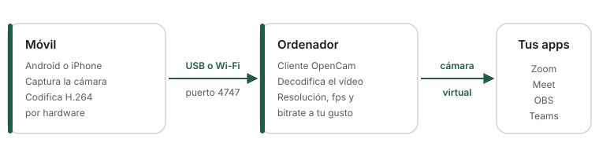

<div align="center">

# OpenCam

**Usa tu móvil como webcam del ordenador. Libre, sin anuncios y sin marcas de agua.**

[](https://github.com/Pausiar/openCam/releases/latest)
[](https://github.com/Pausiar/openCam/actions/workflows/ci.yml)
[](https://pausiar.github.io/openCam/)

[Web y descargas](https://pausiar.github.io/openCam/) ·
[Releases](https://github.com/Pausiar/openCam/releases/latest) ·
[Cómo empezar](#cómo-empezar) ·
[Compilar](#compilar-desde-el-código)

</div>

OpenCam convierte un móvil Android o un iPhone en la cámara web de tu PC. El móvil graba y comprime el vídeo por hardware, lo manda por **USB o Wi-Fi**, y el cliente de escritorio lo publica como **cámara virtual**. Así cualquier app de vídeo (Zoom, Meet, Teams, OBS, Discord…) la ve como una webcam más.

<p align="center">
  
</p>

<!--
  CAPTURAS PENDIENTES. Cuando las tengas, guárdalas en site/img/ y descomenta este bloque:

<p align="center">
  
  
</p>
-->

## Qué ofrece

- **Resolución, fps y bitrate a tu elección**: 1080p, 720p o 480p, a 30 fps o más si tu móvil lo admite, con el bitrate que quieras (`--width`, `--height`, `--fps`, `--bitrate`).
- **USB o Wi-Fi**: por cable con `adb forward` (Android) o usbmuxd (iPhone), o por la red local. En Wi-Fi el ordenador encuentra el móvil solo (mDNS, `--discover`).
- **Vídeo H.264 por hardware**: el móvil apenas se calienta y la latencia es baja.
- **Reconexión automática**: si se corta el cable o la Wi-Fi, el cliente vuelve a conectar sin que reinicies nada.
- **Cámara virtual de verdad** en Windows (DirectShow), Linux (v4l2loopback) y macOS (extensión de cámara CoreMediaIO).
- **Código abierto**: protocolo documentado ([`docs/PROTOCOL.md`](docs/PROTOCOL.md)) y nada de cuentas ni telemetría.

## Descargas

Todo sale de la [última release](https://github.com/Pausiar/openCam/releases/latest). También puedes descargar desde la [web del proyecto](https://pausiar.github.io/openCam/).

| Plataforma | Archivo | Estado |
|---|---|---|
| Android | [`opencam-android.apk`](https://github.com/Pausiar/openCam/releases/latest/download/opencam-android.apk) | Tests en CI. Sin probar en un móvil real. |
| Windows (instalador) | [`opencam-setup-windows-x86_64.exe`](https://github.com/Pausiar/openCam/releases/latest/download/opencam-setup-windows-x86_64.exe) | Compila en CI. Sin probar en Windows. |
| Windows (cliente suelto) | [`opencam-desktop-windows-x86_64.exe`](https://github.com/Pausiar/openCam/releases/latest/download/opencam-desktop-windows-x86_64.exe) | Igual que el instalador, sin registrar la cámara. |
| Windows (cámara virtual suelta) | [`opencam-vcam-windows-x86_64.dll`](https://github.com/Pausiar/openCam/releases/latest/download/opencam-vcam-windows-x86_64.dll) | Para registrarla a mano con `regsvr32`. |
| Linux (cliente + instalador) | [`opencam-linux-x86_64.tar.gz`](https://github.com/Pausiar/openCam/releases/latest/download/opencam-linux-x86_64.tar.gz) | Compila y tiene tests. Sin probar con el módulo cargado. |
| Linux (cliente suelto) | [`opencam-desktop-linux-x86_64`](https://github.com/Pausiar/openCam/releases/latest/download/opencam-desktop-linux-x86_64) | Igual, sin el instalador de la cámara. |
| macOS (Apple Silicon) | [`opencam-desktop-macos-arm64-…-solo-y4m`](https://github.com/Pausiar/openCam/releases/latest/download/opencam-desktop-macos-arm64-sin-camara-virtual-solo-y4m) | Cliente. La cámara virtual (`OpenCam.app`) se compila desde [`macos/`](macos/README.md) con una cuenta de Apple Developer. |
| iPhone | Sin descarga | Se compila desde [`ios/`](ios/README.md) con Xcode. |

> [!NOTE]
> OpenCam está en desarrollo. La columna **Estado** dice con sinceridad qué se ha probado y qué solo compila. Si lo pruebas en tu equipo, [cuéntanos cómo te ha ido](https://github.com/Pausiar/openCam/issues).

## Cómo empezar

### 1. Prepara el móvil

**Android**

1. Instala la APK (Android te pedirá permitir instalar apps de fuentes desconocidas).
2. Abre OpenCam, da permiso de cámara y pulsa **Iniciar**.

**iPhone**

1. Compila la app desde [`ios/`](ios/README.md) con XcodeGen y Xcode, en un Mac con tu firma de Apple.
2. Ábrela y pulsa **Iniciar**. Déjala en primer plano: iOS no deja usar la cámara en segundo plano.

### 2. Conecta el ordenador

<details open>
<summary><b>Windows</b></summary>

1. Ejecuta `opencam-setup-windows-x86_64.exe`. Instala el cliente y registra la cámara virtual **OpenCam Virtual Camera**.
2. Conecta el móvil:
   - Por USB (Android): `adb forward tcp:4747 tcp:4747` y luego `opencam-desktop 127.0.0.1:4747`.
   - Por Wi-Fi: `opencam-desktop 192.168.1.50:4747` (la IP del móvil, en sus ajustes de Wi-Fi), o `opencam-desktop --discover` para buscarlo.
3. En Zoom, Meet, OBS… elige **OpenCam Virtual Camera**.

</details>

<details>
<summary><b>Linux</b></summary>

```bash
# Una vez: instala v4l2loopback y crea la cámara "OpenCam" (vuelve en cada arranque)
tar xzf opencam-linux-x86_64.tar.gz && cd opencam-linux-x86_64
sudo ./install.sh ./opencam-desktop

# Cada vez: conecta el móvil (USB o Wi-Fi) y arranca
opencam-desktop
```

Luego elige **OpenCam** como cámara en tu app. El cliente encuentra solo el dispositivo (`--device auto`).

</details>

<details>
<summary><b>macOS</b></summary>

1. Compila `OpenCam.app` desde [`macos/`](macos/README.md) con tu cuenta de Apple Developer y cópiala a Aplicaciones.
2. Ábrela, pulsa **Instalar cámara** y acepta el permiso en Ajustes del Sistema.
3. Arranca el cliente: `./opencam-desktop-macos-arm64-sin-camara-virtual-solo-y4m`. En tu app de vídeo, elige **OpenCam**.

Sin `OpenCam.app` el cliente puede sacar el vídeo en Y4M: `... --sink y4m | ffplay -`. El binario no va firmado: la primera vez ábrelo con clic derecho → **Abrir**.

</details>

### 3. Ajusta la calidad

```bash
opencam-desktop 127.0.0.1:4747 --width 1280 --height 720 --fps 60 --bitrate 6000
```

| Opción | Por defecto | Qué hace |
|---|---|---|
| `--width` / `--height` | `1920` × `1080` | Resolución que se pide al móvil. |
| `--fps` | `30` | Fotogramas por segundo. |
| `--bitrate` | `8000` | Bitrate de vídeo en kbps. Bájalo si la Wi-Fi va justa. |
| `--device` | `auto` | Dispositivo v4l2loopback (Linux); `auto` usa el llamado OpenCam. |
| `--sink` | según el sistema | `v4l2`, `windows`, `macos` o `y4m`. |
| `--discover` | | Busca móviles con OpenCam en la red local. |
| `--list` | | Lista los móviles disponibles (Wi-Fi e iPhone por USB). |
| `--no-reconnect` | | No reintenta la conexión si se corta. |

La lista completa está en `opencam-desktop --help`.

<!-- CAPTURA PENDIENTE: site/img/captura-ajustes.png (terminal con el cliente conectado mostrando resolución y fps) -->

## Estado por plataforma

| Plataforma | Qué hay | Verificado |
|---|---|---|
| Android | App Kotlin con Camera2 y MediaCodec. USB (`adb forward`) y Wi-Fi. Anuncio por NSD. | APK firmada y tests unitarios en CI. Sin probar en un móvil real. |
| iPhone | App Swift con AVFoundation y VideoToolbox. USB (usbmuxd) y Wi-Fi con Bonjour. | Compila en CI para el simulador. Sin probar en un iPhone. |
| Linux | Cliente Rust que publica en `/dev/videoN` con v4l2loopback, e instalador del módulo (`desktop/linux/install.sh`). | Compila y tiene tests. Sin probar con el módulo cargado. |
| Windows | Cliente Rust, filtro DirectShow (`opencam_vcam.dll`) e instalador NSIS. | Compila en CI. Sin ejecutar en Windows. |
| macOS | Cliente Rust y `OpenCam.app` con una extensión de cámara CoreMediaIO (`macos/`). | Compila en CI (sin firmar). Sin probar en un Mac. |

Más detalle en [`docs/ARCHITECTURE.md`](docs/ARCHITECTURE.md), [`desktop/README.md`](desktop/README.md), [`macos/README.md`](macos/README.md) e [`ios/README.md`](ios/README.md).

## Compilar desde el código

```bash
cd core && cargo test                 # protocolo, cola, métricas, bitrate, reconexión
cd desktop && cargo build --release   # cliente de escritorio
cd desktop && cargo test
cd android && ./gradlew :app:assembleDebug
cd ios && xcodegen generate           # luego abre OpenCam.xcodeproj en Xcode (macOS)
cd macos && xcodegen generate         # cámara virtual de macOS: abre OpenCamMac.xcodeproj
```

La cámara virtual de Windows es un crate aparte: `cd desktop/windows-vcam && cargo build --release` (en Windows, toolchain MSVC).

Las releases se generan solas al subir un tag `v*` (ver [`.github/workflows/release.yml`](.github/workflows/release.yml)). La web de [`site/`](site/index.html) se publica en GitHub Pages en cada cambio a `main`.

## Documentación

- [`docs/ARCHITECTURE.md`](docs/ARCHITECTURE.md): arquitectura, fases y estado.
- [`docs/PROTOCOL.md`](docs/PROTOCOL.md): protocolo OPCM v1 entre móvil y escritorio.

## Contribuir

Los reportes de prueba en hardware real son lo que más ayuda ahora mismo. Abre un [issue](https://github.com/Pausiar/openCam/issues) con tu móvil, tu sistema y lo que viste.

## Licencia

El repositorio no incluye todavía un fichero de licencia.
